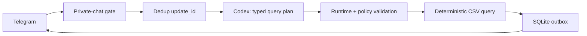

<div align="center">

# 🤖 Smart Telegram Assistant Starter

### Умный Telegram-бот, который читает таблицы предсказуемо

**Codex понимает вопрос и строит строгий план. Обычный код проверяет план, читает CSV и считает ответ.**


</div>

> Этот репозиторий — только про Telegram-бота. Здесь нет веб-интерфейса, календаря или todo-планировщика.

## Зачем он нужен

Типичная ошибка «умного бота»: отдать нейросети всю таблицу и попросить самой найти ответ. На больших, грязных или часто меняющихся таблицах модель пропускает строки, ошибается в суммах и может принять текст из ячейки за инструкцию.

Здесь ответственность разделена:



Codex получает только названия и описания разрешённых колонок. Строки таблицы ему не передаются. Фильтрацию, сортировку, `count`, `sum` и `average` выполняет TypeScript.

## Что уже работает

- Telegram long polling без публичного HTTP-сервера.
- Доступ только владельцу и только в личном чате.
- `codex exec --output-schema`: свободный вопрос превращается в типизированный read-only план.
- Независимая runtime-проверка источников, колонок, операторов и лимитов.
- CSV с кавычками, переносами, стабильным primary key и provenance строки.
- Детерминированные `lookup`, `list`, `count`, `sum`, `average`.
- Идемпотентность по `update_id` и SQLite outbox: повтор Telegram update не создаёт второй ответ.
- Короткий контекст продолжения без передачи значений ячеек обратно модели.
- Ограничение очереди/таймаут Codex, безопасный env allowlist, HTML escaping.
- Тесты на группы, не-владельца, duplicate keys, prompt injection в ячейке и выдуманные поля.

## Быстрый старт

Нужны [Bun](https://bun.sh) и авторизованный Codex CLI.

```bash
git clone https://github.com/artemmarketolog/smart-telegram-assistant-starter.git
cd smart-telegram-assistant-starter
bun install

# Проверить мозг и демонстрационную таблицу без Telegram:
bun run demo "Какая сумма оплаченных заказов у Анны?"
```

Ожидаемый результат: сумма `324 500` по двум строкам. Число считает код, не модель.

Для запуска Telegram:

```bash
cp .env.example .env
cp config/sources.example.json config/sources.json
cp examples/orders.csv data-sources/orders.csv
```

Заполните в `.env` локально:

```dotenv
TELEGRAM_BOT_TOKEN=ваш_токен_от_BotFather
TELEGRAM_OWNER_ID=ваш_числовой_Telegram_ID
```

Не отправляйте значения токенов coding agent, в issue или в чат. Затем:

```bash
bun run doctor
bun run check
bun run start
```

Напишите своему боту:

- `Какой статус у заказа ORD-1002?`
- `Сколько оплаченных заказов у Анны?`
- `Какая сумма оплаченных заказов?`
- `/sources`

## Отдать репозиторий своему агенту

Откройте [START-HERE.md](START-HERE.md), скопируйте готовое задание и добавьте описание своей таблицы. Агент сначала адаптирует фикстуры и mapping, прогонит тесты и только потом попросит вас самостоятельно заполнить `.env`.

Главные контракты:

- [AGENTS.md](AGENTS.md) — обязательные правила для coding agent.
- [SPEC.md](SPEC.md) — технический контракт.
- [Таблицы](docs/TABLES.md) — CSV, Google Sheets и стабильные ID.
- [Безопасность](SECURITY.md) — реальные гарантии и ограничения.
- [Деплой](docs/DEPLOYMENT.md) — отдельный Unix-user и один poller.
- [Troubleshooting](docs/TROUBLESHOOTING.md) — частые ошибки.

В папке [`skills/build-safe-telegram-assistant`](skills/build-safe-telegram-assistant/) лежит тот же workflow в формате переносимого Codex skill.

## Подключить свою таблицу

Минимально:

1. Добавьте CSV в `data-sources/`.
2. Опишите разрешённые колонки и стабильный primary key в `config/sources.json`.
3. Добавьте вопросы и ожидаемые планы в тесты.
4. Выполните `bun run check`.

Для Google Sheets не давайте модели ссылку и не просите её читать браузером. Агент должен добавить отдельный read-only sync/adapter с фиксированными `spreadsheet_id` и `range`, минимальным scope и локальным CSV snapshot. Подробности — в [docs/TABLES.md](docs/TABLES.md).

## Граница безопасности

`codex exec -s read-only` запрещает запись в sandbox, но это не доказательство полной невозможности чтения других доступных файлов. Для рабочих данных запускайте brain под отдельным Unix-пользователем или в контейнере, где нет файлов приложения, таблиц и посторонних credentials. Telegram/Sheets secrets остаются только у доверенного процесса, а любой ответ модели считается недоверенным планом.

Запись и удаление данных в эталоне намеренно отсутствуют. Если они действительно нужны, используйте схему `proposal → validation → preview → confirmation → execute → readback`; см. [docs/ACTIONS.md](docs/ACTIONS.md).

## Лицензия

[MIT](LICENSE).
